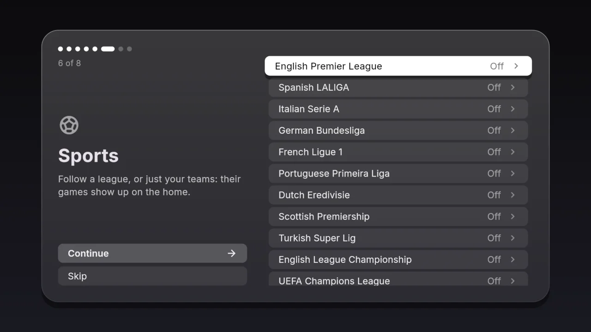

<div align="center">

# Ilona TV

**A calm, beautiful home screen for Fire TV and Google TV.**

Your apps, what to watch next and today's games on one screen, in a liquid-glass look,<br>
driven by the remote alone.

[](LICENSE)


</div>

## Why Ilona TV

The stock TV homes push ads and whatever their store wants you to watch. Ilona TV shows **your** apps and **your** things to watch, and gets out of the way.

- **Rows that matter.** Trending movies and series, recommendations, Continue watching from Stremio, your YouTube feed, and live games from the leagues you follow, with your teams first.
- **Opens where you watch.** A title opens in Stremio, or in whichever of *your* streaming apps carries it in your country: Netflix, Prime Video, Disney+, Max and the rest.
- **Filter by service and genre.** Press Left on a row to see what's popular right now on one service, or in one genre.
- **Your dock, your way.** Up to five app tiles, each with a painted icon, the app's own icon or a picture of your own.
- **Takes over the Home button**, even on Fire TV, where the Amazon home can't normally be replaced.
- **Set up in minutes.** A first-run wizard walks you through everything. Sign-ins happen on your phone, so there's no typing passwords with a remote.
- **Your phone as a remote.** The [Ilona TV Companion](#phone-remote-and-installer) pairs with the QR code in Settings > Companion, for searching, watching and typing on your phone instead of the remote.
- **Private.** No cloud server, no account, no analytics. Everything stays on the TV.

Plus the weather, the TV's HDMI inputs with console control over HDMI-CEC (Fire TV Edition TVs), a voice assistant powered by your own Gemini key (Fire TV), and English and Portuguese.

## The first run

A short setup on the TV gets everything in place, and anything that needs typing can be done from your phone.

| | |
| :---: | :---: |
|  |  |
| **Welcome**: pick the language, or scan the QR to set up from your phone | **TMDB key**: a guide with pictures for every step |
|  |  |
| **Where titles open**: Stremio, or your own streaming apps | **Sports**: follow a league or just your teams |

## Phone remote and installer

The Ilona TV Companion is an Android app that does the computer steps below from your phone, then stays on as a remote.

- **Install** Ilona TV on a Fire TV: it finds the TV on your Wi-Fi, asks for the "Allow debugging?" prompt, downloads the right APK from the latest [release](../../releases) (checking its SHA-256), installs it, grants the permissions Launcher mode and Processes need, and starts it.
- **Pair** with the QR code or the code from Settings > Companion.
- **Remote:** the keys, Back and Home, search and browse with Watch, and typing during the setup.

Download `ilonatv-companion.apk` from the [Releases](../../releases) page, sideload it on your phone, then choose "Install Ilona TV on a TV". To build it yourself, see [development](docs/development.md#companion).

Before you start, turn on ADB debugging on the TV (see step 1 of Get started, with video walkthroughs). The phone installer works on Fire TV and on Android TV devices that offer ADB network debugging on port 5555. Google TV and Android 11+ only offer "Wireless debugging", which needs pairing from a computer: follow Get started below. Once Ilona TV is installed you can turn ADB debugging off; the remote does not use it.

## Get started

**You need:** a Fire TV, Google TV or Android TV device on Android 9 or later, a computer on the same network, and a free [TMDB](https://www.themoviedb.org) account for the movie and series rows. The setup on the TV shows how to get the TMDB key.

1. **Turn on debugging on the TV.**
   - *Fire TV:* Settings > My Fire TV > Developer options > ADB debugging. If Developer options is missing, open Settings > My Fire TV > About and press OK on the device name seven times. Video walkthroughs: [unlocking Developer options](https://www.youtube.com/watch?v=_Ixo7wR9njU) and [turning on ADB debugging](https://www.youtube.com/watch?v=xHktMEhgrtU).
   - *Google TV / Android TV:* Settings > System > About, press OK on "Android TV OS build" seven times, then Settings > System > Developer options > USB debugging.

   Then note the TV's IP address from its network settings.

2. **Install** [adb](https://developer.android.com/tools/releases/platform-tools) on the computer and connect. Accept the "Allow debugging?" prompt on the TV.

   ```sh
   adb connect <tv-ip>:5555
   adb shell getprop ro.product.cpu.abilist   # arm64-v8a? use ilonatv-arm64-v8a.apk; otherwise ilonatv-armeabi-v7a.apk
   ```

3. **Install Ilona TV** from the [Releases](../../releases) page (`ilonatv-armeabi-v7a.apk` fits most Fire TV devices; `SHA256SUMS` lists the checksums). To build it yourself, see [development](docs/development.md#build).

   ```sh
   adb install -r ilonatv-armeabi-v7a.apk
   adb shell am start -n tv.ilona.app/.MainActivity
   ```

4. **Follow the setup on the TV.** Every step can be skipped and changed later in Settings.

To make Home always bring you back to Ilona TV, turn on **Launcher mode** in Settings. On Fire TV that needs one more adb command, which the screen shows you. Details are in [docs/launcher-mode.md](docs/launcher-mode.md).

## How titles open

Pick this in the setup or in Settings > Open with, separately for movies and series.

| | **Stremio app** | **My streaming apps** |
| --- | --- | --- |
| A title opens | On its page in Stremio, or straight into the first stream | In the installed app of a service that has it in your country |
| The rows show | Stremio's popular titles, Continue watching | What's popular now on the services you mapped |
| You need | A Stremio app; an account for Continue watching | A TMDB key; your services mapped to their apps |

Streaming apps open on their own home, not at the title: the services don't publish links into their apps. Videos and trailers open in the YouTube app you choose; SmartTube and the official app both work.

## FAQ

<details>
<summary><b>Do I need Stremio?</b></summary>

No. Choose "My streaming apps" and Ilona TV works with the apps you already have. Stremio adds Continue watching, and lets games open in a sports add-on.
</details>

<details>
<summary><b>Why does it need adb?</b></summary>

To install an app that isn't in the store, and, on Fire TV, to grant the one permission Launcher mode needs. Ilona TV shows the exact commands on screen. After setup you can turn debugging off again.
</details>

<details>
<summary><b>Will it work on my device?</b></summary>

It runs day to day on a Fire TV Stick 4K (Fire OS 7) and a Fire TV Edition TV (Fire OS 8). Google TV and other Android TV devices should work but haven't been tried on real hardware yet. Reports are very welcome.

Fire TV devices that run Amazon's Vega OS instead of Fire OS (such as the Fire TV Stick 4K Select) don't run Android apps, so Ilona TV can't be installed on them. See [AFTVnews' list of Fire TVs without sideloading](https://www.aftvnews.com/these-are-the-fire-tvs-that-dont-support-sideloading-or-downloader-due-to-vega-os-replacing-fire-os/).
</details>

<details>
<summary><b>Is there a phone app?</b></summary>

Yes, the [Ilona TV Companion](#phone-remote-and-installer) for Android. It talks to the TV only on the local network, never over the internet, and Ilona TV answers only phones you paired. Settings > Companion shows the QR code and the code to pair with, and lists the paired phones, each with Remove.
</details>

<details>
<summary><b>How do I put my own picture on an app tile?</b></summary>

Copy the picture to the TV (`adb push picture.png /sdcard/Download/`, a USB stick or a file manager app). Then, in the tile editor, choose Choose icon > Custom image…, and pick Fill or Centered on a colour.
</details>

<details>
<summary><b>How do I undo it?</b></summary>

Turn Launcher mode off, or simply uninstall Ilona TV. On Google TV, if you disabled the stock launcher, `adb shell pm enable` it again (see [docs/launcher-mode.md](docs/launcher-mode.md)).
</details>

## More

- [Launcher mode](docs/launcher-mode.md): how Home is taken over on each platform, and its limits.
- [Privacy and permissions](docs/privacy-and-permissions.md): every service Ilona TV talks to, and why each permission is there.
- [Development](docs/development.md): building, signing, tests and profiling.

## Disclaimer

Ilona TV is an independent project, not affiliated with or endorsed by YouTube, Google, Stremio, TMDB, JustWatch, ESPN, Amazon, Netflix or any other service it opens or talks to. Some of them are used through unofficial interfaces that may stop working at any time; use each according to its terms. Ilona TV provides no video content: it opens the apps and add-ons you install, and you're responsible for watching only what you have the right to. Product names, logos and the console wordmarks belong to their owners.

This product uses TMDB and the TMDB APIs but is not endorsed, certified, or otherwise approved by TMDB. Where-to-watch data is provided by [JustWatch](https://www.justwatch.com).

## Licence

Copyright (C) 2026 hiitsgabe and the Ilona TV contributors. Ilona TV is free software under the [GNU General Public License v3.0](LICENSE) (`GPL-3.0-only`). The bundled Inter font is under the SIL Open Font License.
